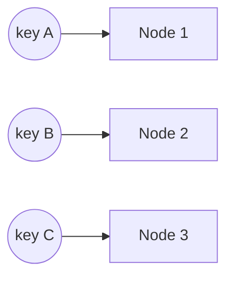

# Consistent Hashing

Map both nodes and keys onto a hash ring; a key belongs to the first node clockwise.

- Adding/removing a node moves only ~K/N keys instead of nearly all.
- **Virtual nodes** (many points per server) smooth out load imbalance.

Used in: DynamoDB, Cassandra, CDNs, distributed caches.
