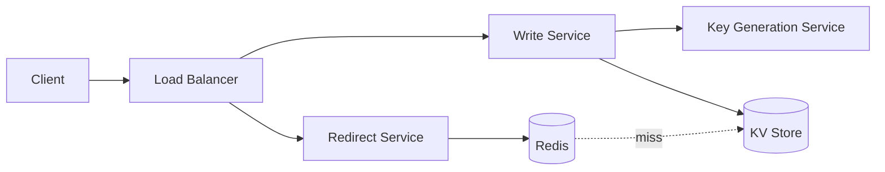

# URL Shortener (TinyURL / bit.ly)

## 1. Requirements
### Functional
- Given a long URL, return a short URL.
- Redirect short URL → long URL.
- Optional custom alias and expiration.
### Non-functional
- Very high availability; redirect latency < 50 ms p99.
- Short codes must not be guessable in sequence (nice to have).
### Out of scope
- User accounts, detailed analytics dashboards.

## 2. Estimation
| Metric | Value |
|---|---|
| New URLs/day | 100M → ~1.2K write QPS |
| Read:write ratio | 10:1 → ~12K read QPS |
| Record size | ~500 B |
| Storage (5 yr) | 100M × 365 × 5 × 500 B ≈ 90 TB |
| Code length | base62, 7 chars → 62^7 ≈ 3.5 trillion |

## 3. API
```
POST /api/v1/urls        { longUrl, alias?, expiresAt? } -> { shortUrl }
GET  /{code}             -> 301/302 Location: longUrl
```
Use **302** if you need click analytics; **301** lets browsers cache and reduces load.

## 4. Data Model
`urls(code PK, long_url, created_at, expires_at)` — key-value access pattern → DynamoDB / Cassandra.

## 5. High-Level Design


## 6. Deep Dives
- **Code generation options:**
  - Hash (MD5/SHA) of URL, take 7 chars → collisions need retry.
  - Global counter + base62 → simple but sequential/guessable; counter is a bottleneck.
  - **Pre-generated key ranges (KGS):** each app server leases a block of IDs → no coordination per request. ✅
- **Caching:** 80/20 rule — cache the hot 20% of codes; LRU in Redis.
- **Expiration:** lazy delete on read + periodic cleanup job.
- **Abuse:** rate limit creation per IP/API key; scan URLs against malware lists.

## 7. Trade-offs & Alternatives
| Decision | Chosen | Alternative | Why |
|---|---|---|---|
| Store | KV (DynamoDB) | Postgres | Simple access pattern, horizontal scale |
| IDs | KGS ranges | Hashing | No collisions, no per-request coordination |
| Redirect | 302 | 301 | Keep analytics option |

## 8. Failure Modes & Monitoring
- Cache down → fall back to DB (ensure DB can absorb read QPS or shed load).
- KGS down → servers keep using leased ranges; lease larger blocks.
- Metrics: redirect p99, cache hit ratio, 404 rate, creation QPS.
