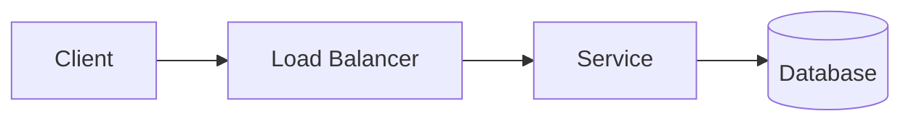

# <System Name>

## 1. Requirements
### Functional
-
### Non-functional
-
### Out of scope
-

## 2. Estimation
| Metric | Value |
|---|---|
| DAU | |
| Read QPS | |
| Write QPS | |
| Storage (5 yr) | |

## 3. API
```
```

## 4. Data Model

## 5. High-Level Design


## 6. Deep Dives
-

## 7. Trade-offs & Alternatives
| Decision | Chosen | Alternative | Why |
|---|---|---|---|

## 8. Failure Modes & Monitoring
-
